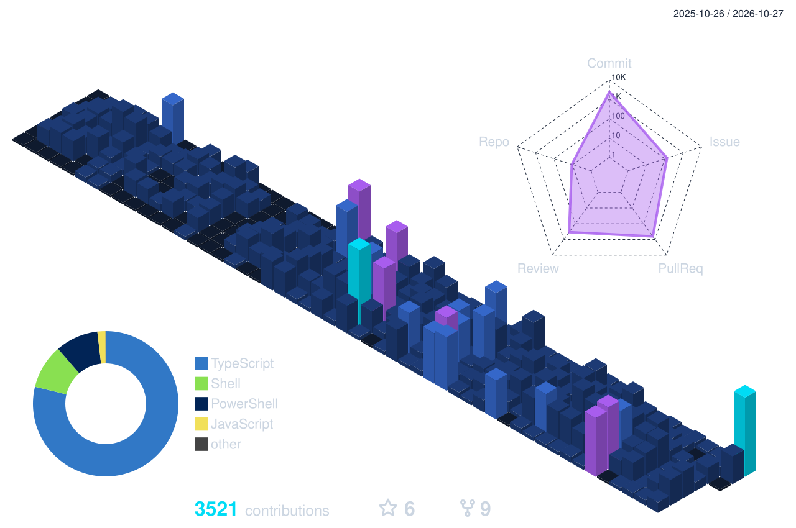

<!-- José Rodriguez · GitHub profile. Generated by scripts/profile/build.mjs: edit scripts/profile/content.mjs, not this file. -->

<b>Tech Lead · Senior Full Stack AI Engineer</b> at <b>Blackstone Studio</b> · AI-native development with AI agents, MCP, RAG and spec-driven development · TypeScript, NestJS, React, Next.js, Node.js, PostgreSQL, AWS · Tepic, Nayarit, México · Open to new opportunities

&nbsp;
&nbsp;

 

<!-- 01 · About -->
<picture>
  <source media="(prefers-color-scheme: light)" srcset="./assets/sections/about-light.svg" />
  
</picture>

 

<!-- 02 · AI-native engineering -->
<picture>
  <source media="(prefers-color-scheme: light)" srcset="./assets/sections/ai-light.svg" />
  
</picture>

 

<!-- 03 · Highlights -->
<picture>
  <source media="(prefers-color-scheme: light)" srcset="./assets/sections/highlights-light.svg" />
  
</picture>

 

<!-- 04 · Now building -->
<picture>
  <source media="(prefers-color-scheme: light)" srcset="./assets/sections/building-light.svg" />
  
</picture>

 

<!-- 05 · GitHub activity -->
<picture>
  <source media="(prefers-color-scheme: light)" srcset="./assets/sections/activity-light.svg" />
  
</picture>

<picture>
  <source media="(prefers-color-scheme: light)" srcset="./profile-3d-contrib/profile-3d-light.svg" />
  
</picture>

<picture>
  <source media="(prefers-color-scheme: light)" srcset="https://raw.githubusercontent.com/isc-joserodriguez/isc-joserodriguez/output/github-snake.svg" />
  
</picture>

 

<!-- 06 · Tech stack -->
<picture>
  <source media="(prefers-color-scheme: light)" srcset="./assets/sections/stack-light.svg" />
  
</picture>

 

<!-- 07 · Credentials -->
<picture>
  <source media="(prefers-color-scheme: light)" srcset="./assets/sections/credentials-light.svg" />
  
</picture>

&nbsp;

 

<b>Plain-text résumé</b> · the same profile as text, for search engines, screen readers and copy-paste

### José Rodriguez · Tech Lead · Senior Full Stack AI Engineer

Tepic, Nayarit, México · Open to new opportunities · [Email](mailto:isc.joserodriguez@gmail.com) · [LinkedIn](https://www.linkedin.com/in/isc-joserodriguez/) · [Portfolio](https://www.jose-rodriguez.dev/)

Tech Lead and Senior Full Stack AI Engineer with 8+ years building web and mobile products end to end. I design AI-native development workflows (AI agents, MCP, RAG and spec-driven development) on top of solid backend architecture, cloud and team leadership.

#### About

- **Tech Lead at Blackstone Studio.** Owning delivery of web and mobile products, from spec to production.
- **AI-native workflows in production.** Multi-agent systems, Skills, MCP, RAG and spec-driven development.
- **30+ products shipped.** Web and mobile platforms delivered end to end for real clients.
- **Teams of up to 8.** Developers, design and QA, working with agile delivery.
- **40+ students mentored.** Mentor in Full Stack JavaScript bootcamps.
- **Clean Architecture, DDD, SOLID.** Systems designed to keep changing for years.

#### AI-native engineering

Spec-driven development with multi-agent workflows: a spec and a plan feed an orchestrator that fans work out to analysis, code, test and documentation agents, grounded by MCP servers, RAG, agent Skills and repository memory, then human review and a CI/CD release.

- **Specify.** Spec-driven development: the spec is the source of truth agents work from.
- **Orchestrate.** Multi-agent workflows that split analysis, code, tests and docs.
- **Ground.** MCP servers and RAG give agents real project context.
- **Verify.** Tests, CI and human review before anything ships.

#### Highlights

- **AI agent platform, in production** (End to end). Automates the development cycle: analysis, code, testing and documentation.
- **PHP core → NestJS + Prisma** (40+ modules). A CodeIgniter monolith rebuilt in TypeScript with AI-assisted flows, zero downtime.
- **Deploy time, cut down** (Days → hours). Release automation on AWS and CircleCI.
- **Whole environments, one tool** (CLI → AWS). CLI tools that deploy complete environments on AWS.
- **Billing and subscriptions** (Automated). Stripe integration that runs billing and subscriptions on its own.

#### Now building

- **AI-native workflows at Blackstone Studio.** Agents, RAG, MCP and spec-driven development applied to real client products.
- **Point of sale.** Sales, inventory and day-to-day business operations.
- **Loan manager.** From credit application to repayments, end to end.
- **Car rental.** The full booking and payment flow.
- **2D web shooter.** An arcade shooter that runs in the browser.
- **Consumer mobile app.** In stealth. More soon.

#### Tech stack

- **AI engineering:** Claude, OpenAI, LangChain, n8n, Ollama, GitHub Copilot, MCP, RAG, AI agents, SDD
- **Frontend & mobile:** React, React Native, Next.js, Angular, Gatsby, Tailwind CSS, MUI, Ant Design, Redux, React Query, React Hook Form, styled-components, Storybook, Sass
- **Backend & APIs:** TypeScript, Node.js, NestJS, Express, GraphQL, Swagger, Strapi, Stripe, PayPal
- **Data:** PostgreSQL, MongoDB, Prisma, MySQL, SQL Server, TypeORM, Mongoose, Sequelize
- **Cloud & DevOps:** AWS, Docker, Kubernetes, GitHub Actions, CircleCI, Firebase, Vercel, Netlify, DigitalOcean, Linux, Vite, Webpack
- **Testing:** Playwright, Jest, Cypress

#### Credentials

- [MongoDB Overview: Core Concepts and Architecture](https://www.credly.com/badges/a0b2686a-0f25-4964-80b0-35d0d047e393), MongoDB, Sep 2026
- [Coach Online Tech - 2022](https://www.credly.com/badges/1fb6182a-c6d3-44f6-a1b6-2fe790f7313b), Utel Universidad, Sep 2022
- [Reconocimiento a la trayectoria 2022](https://www.credly.com/badges/6706b658-72b0-437a-98d5-31e0d35ca871), Utel Universidad, Apr 2022
- [Full Stack JavaScript Santander Universidades](https://www.credly.com/badges/e5c9ffae-62af-4a65-b7f5-76732841ee9f), BEDU, Aug 2021
- [Prototype - Full Stack JavaScript Santander Universidades](https://www.credly.com/badges/2fc280c0-e7ce-43fb-a033-c932864e2bc5), BEDU, Aug 2021

#### GitHub, last 12 months

3,719 contributions on 300 active days · 1,751 pull requests (97% merged) · 173 repositories · longest streak 61 days

